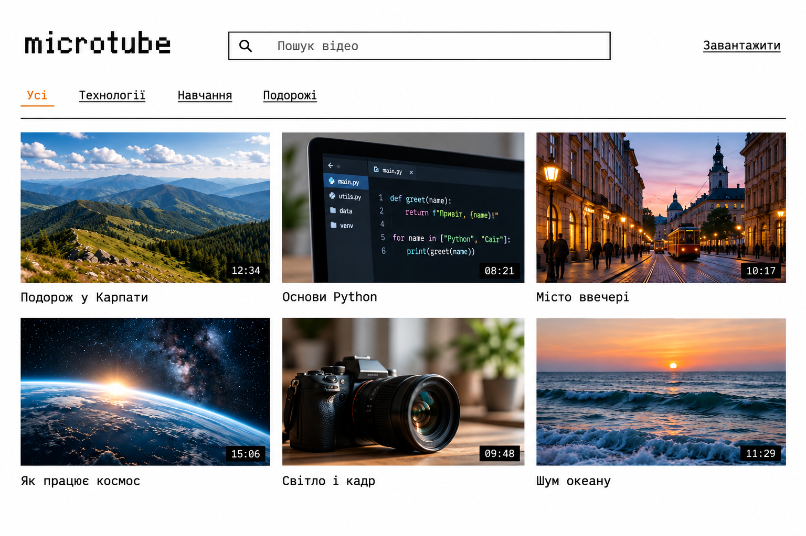

# microtube
A YouTube clone without the bloatware | student project

**This a a student pet project.** We are aiming to create a scalable cluster with a minimalistic video player.

---


## Launch

On the first run, copy `.env.example` to `.env` and set `POSTGRES_PASSWORD`.
Keep your existing `.env` when updating. For an existing database, use its current password.

```bash
cp .env.example .env
```

```bash
docker compose up -d --build
```

The first AI startup downloads the model; subsequent starts reuse its cache.
To wait for startup checks, use `docker compose up -d --build --wait --wait-timeout 1200`.

| Service | Local address | Current role |
| --- | --- | --- |
| `frontend-main` | http://127.0.0.1:8080 | Frontend placeholder |
| `frontend-upload` | http://127.0.0.1:8082 | Plain multipart upload form |
| `frontend-monitor` | http://127.0.0.1:8081 | Monitor page placeholder |
| `backend-video` | http://127.0.0.1:3030/docs | Video API placeholder |
| `backend-text` | http://127.0.0.1:3031/docs | Text API placeholder |
| `backend-upload` | http://127.0.0.1:3032/docs | Receives a file and metadata |
| `backend-indexing` | No HTTP endpoint | Background worker saving video and tag embeddings |
| `backend-ai-video` | http://127.0.0.1:4001/docs | Video embeddings |
| `backend-ai-text` | http://127.0.0.1:4002/docs | Text embeddings |
| `db-videos` | Internal: `db-videos:5432` | PostgreSQL database `videos` |
| `db-users` | Internal: `db-users:5432` | Empty PostgreSQL database `users` |

The upload form posts `file`, `title`, `description`, and `tags` to `/upload` on
`UPLOAD_API_PORT` (default `3032`) on the same host as the page. Tags are separated
by whitespace. The browser displays the JSON response; no `fetch` or CORS setup
is needed for this native form submission. The endpoint stores the file in
`/videos/<id>`, writes its metadata to PostgreSQL, and returns `stored: true`.

In `backend-indexing`, the worker polls unindexed videos every 60 seconds.
`run(video)` claims a video with a PostgreSQL session advisory lock and sets
`processing_now = true`, then requests a video embedding and one text embedding
per tag. Valid 768-dimensional vectors are saved to `vectors` as
`{"video": [...], "text": [[...], ...]}` with tag vectors in metadata order.
The vectors, `indexed = true`, and `processing_now = false` are committed together.
On error, the video remains unindexed and is retried on the next poll; other videos
continue processing. Session locks are released on disconnect, so interrupted
videos can be picked up again even if `processing_now` was left true.
Completed videos are skipped. Successes and errors are logged.

`GET /embedding/text?text=dog` returns a normalized 768-dimensional vector. The
text service uses the same model and shared model cache as the video service,
with the unused vision and audio encoders disabled. `TEXT_AI_PORT` defaults to
`4002` on the host; both AI containers use port `4001` internally.

Useful commands:

```bash
docker compose ps
docker compose logs -f backend-ai-video
docker compose stop
docker compose exec db-videos psql -U admin -d videos
```

note: docker compose creates a shared network

volumes: `microtube-videos-db`, `microtube-users-db`,`microtube-videos`, and `microtube-hf-cache`. They survive container recreation and `docker compose down`. 

Files are stored as `/videos/<id>`; the database stores this ID in `hash` and the JSON metadata in `metadata`.
