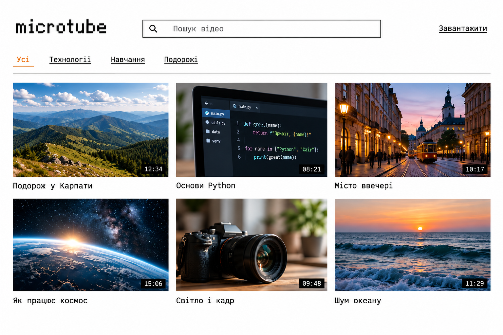

# microtube
A YouTube clone without the bloatware | student project

MicroTube is a Docker Compose project with a minimal video player, public
playback, authenticated uploads and a personalized home feed.

---



The renders are design targets for the pixel-style interface. The header offers
light, dark and system themes. [Home render](assets/main-page.png) ·
[Watch render](assets/video-page.png) · [Design rules](AGENTS.md#visual-design-system-all-frontends)

Earlier interface previews use demo content. [Light home](docs/screenshots/home.jpg) ·
[Dark home](docs/screenshots/home-dark.jpg) · [Watch](docs/screenshots/watch.jpg) ·
[Mobile watch](docs/screenshots/watch-mobile.jpg)

Watch pages with real uploaded metadata. [Desktop](docs/screenshots/watch-live.jpg) ·
[Mobile](docs/screenshots/watch-mobile-live.jpg)

## Launch

On the first run, copy `.env.example` to `.env` and set `POSTGRES_PASSWORD`.
Keep the existing `.env` and database password when upgrading.

Start the full cluster. The first launch downloads the embedding models.

```sh
docker compose up -d --build --wait --wait-timeout 3600
```

To start or rebuild one service, replace `frontend-upload` with its Compose name.
Compose also starts any declared dependencies.

```sh
docker compose up -d --build frontend-upload
```

These addresses use the defaults in `.env.example`.

| Service | Local address | Role |
| --- | --- | --- |
| `frontend-main` | [Home](http://127.0.0.1:8080/) | Feed and player |
| `frontend-monitor` | [Status](http://127.0.0.1:8081/) | HTTP availability |
| `frontend-upload` | [Upload](http://127.0.0.1:8082/) | Upload form and progress |
| `frontend-auth` | [Account](http://127.0.0.1:8083/) | Registration and sign-in |
| `backend-video` | [Docs](http://127.0.0.1:3030/docs) | Streaming, thumbnails and feed |
| `backend-text` | [Docs](http://127.0.0.1:3031/docs) | Semantic search |
| `backend-upload` | [Docs](http://127.0.0.1:3032/docs) | Upload API |
| `backend-auth` | [Docs](http://127.0.0.1:3033/docs) | Session API |
| `backend-ai-video` | [Docs](http://127.0.0.1:4001/docs) | Video embeddings |
| `backend-ai-text` | [Docs](http://127.0.0.1:4002/docs) | Text embeddings |
| `backend-indexing` | Internal worker | Indexing |
| `db-videos`, `db-users` | Internal port 5432 | PostgreSQL |

`BIND_ADDRESS` selects the host interface for published ports and defaults to
`127.0.0.1`. Navigation uses the default frontend ports. Use the same hostname
for Account, Upload and Home so the pages share a session cookie.

## Using MicroTube

Sign in through Account, then open Upload. Choose an MP4 and give it a title.
Description, whitespace-separated tags and a thumbnail are optional. The upload
API accepts JPEG, PNG and WebP thumbnails up to 16 megapixels. An empty
picker uses the first video frame. Video and thumbnail files have no fixed
byte limit. Allow disk space for the temporary upload and the stored video chunks.
The form clears after a successful upload. Retrying the same submission
returns its original video ID if the first request already saved it.

Open the returned watch link to play the video or share its ID. Watch pages
load titles, descriptions and tags from PostgreSQL and use native video
controls with HTTP Range seeking.

Home loads 24 cards at a time as you scroll. Guests and accounts with too
little history get a shuffled catalog. For signed-in users, the player
records a view after 30 seconds of playback or half the clip, whichever is
shorter. The first personal feed uses 25 distinct watched videos with ready
embeddings and refreshes after five more eligible views.

Sessions default to one hour. Restarting auth signs users out. The browser
uses double SHA-256 hashes as credentials for this prototype. Browser hashing
requires HTTPS outside localhost. Set `AUTH_COOKIE_SECURE=true` when serving
the app over HTTPS. [Authentication details](AGENTS.md#authentication)

## Current limitations

- Cards show JPEG previews and placeholder durations. Related videos on the
  watch page are planned.
- The main page filters loaded titles. Semantic search is available through
  the authenticated API and uses video and tag embeddings.
- The monitor checks HTTP availability. Use Compose logs for indexing and
  database issues.

## API quick reference

The backend routes are listed below. The main frontend proxies the video
routes through `/api/video/`. API clients can send a session cookie or a
Bearer token for authenticated calls. Cookie-authenticated writes require a
matching Origin.

| Backend | Route | Result |
| --- | --- | --- |
| Video | `GET /feed?limit=24` | Personal or shuffled cards with a continuation cursor |
| Video | `GET /catalog?limit=24&after=<id>` | Public catalog ordered by ID |
| Video | `GET /thumbnail?id=<id>` | JPEG preview |
| Video | `GET /metadata?id=<id>` | Title, description and tag names |
| Video | `GET /videos?id=<id>` | MP4 playback with Range support |
| Video | `POST /history?id=<id>` | Records an authenticated view |
| Upload | `POST /upload` | Authenticated multipart upload |
| Text | `GET /search?req=fox&limit=20` | Ranked results for a signed-in user |

## Data and upgrades

PostgreSQL stores metadata, embeddings, accounts and viewing history.
For video ID `Ab12_cdE`, the 64 MiB media parts live in `/videos/Ab/12_cdE/`
and the JPEG preview lives at `/videos/Ab/12_cdE.jpg`. Older uploads get a
preview on their first thumbnail request. The media, database and model
cache volumes survive container recreation.

Fresh databases initialize their schemas automatically. To upgrade an
existing pgvector database from before the personalized feed, run the feed
migration once with `db-videos` running.

```sh
docker compose exec -T db-videos sh -c 'exec psql -v ON_ERROR_STOP=1 -U "$POSTGRES_USER" -d "$POSTGRES_DB"' < db/videos/recommendations.sql
```

For an older users volume missing its table, apply the users schema once
with `db-users` running.

```sh
docker compose exec -T db-users sh -c 'exec psql -v ON_ERROR_STOP=1 -U "$POSTGRES_USER" -d "$POSTGRES_DB"' < db/users/init.sql
```

Volumes with the old JSONB vector schema need a pgvector migration before
using the current services. [Schema and storage details](AGENTS.md#storage-and-upload)

## Development

Use the single-service command after changes to frontend HTML or page-local
JavaScript. Shared CSS and theme JavaScript are mounted from `frontend/shared/`
and update on browser reload. Restart consumers after shared Python changes.

Use `docker compose config --quiet` to validate configuration and
`docker compose ps` to check service health. Service contracts, storage and
indexing internals, and contributor rules are in [AGENTS.md](AGENTS.md).
